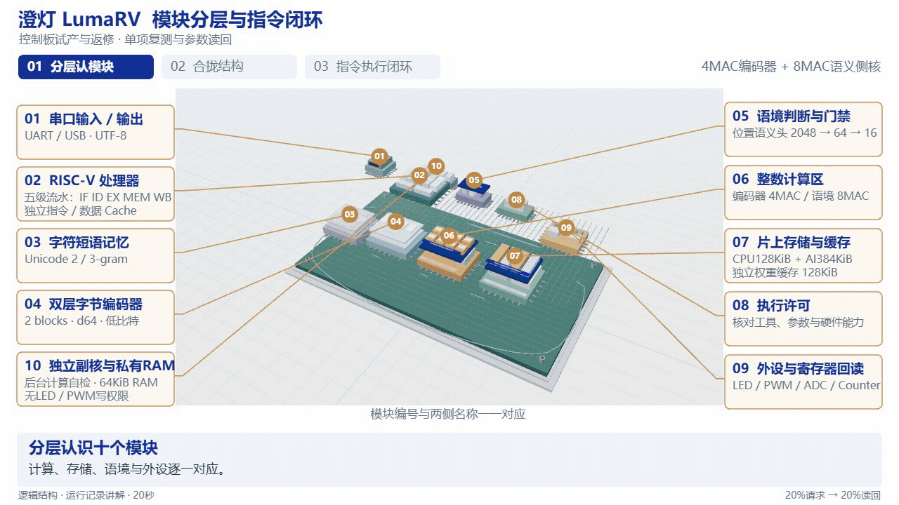
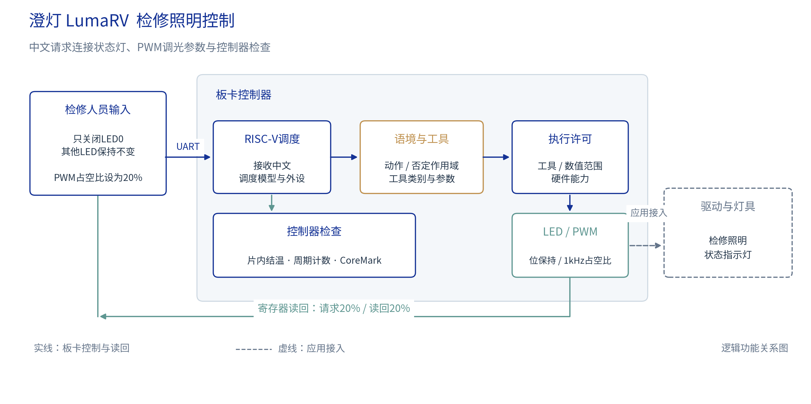
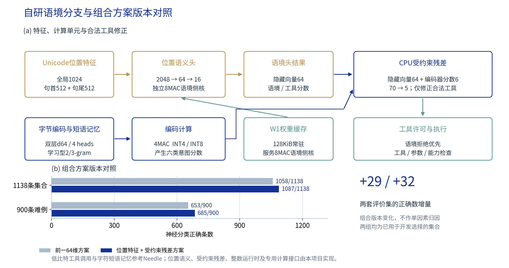
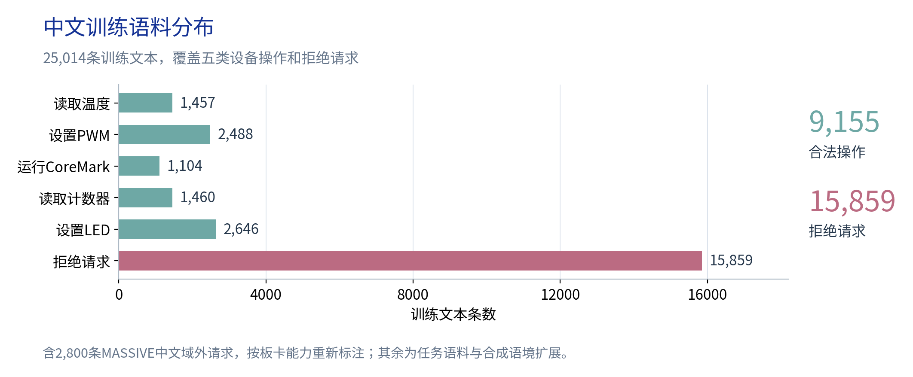
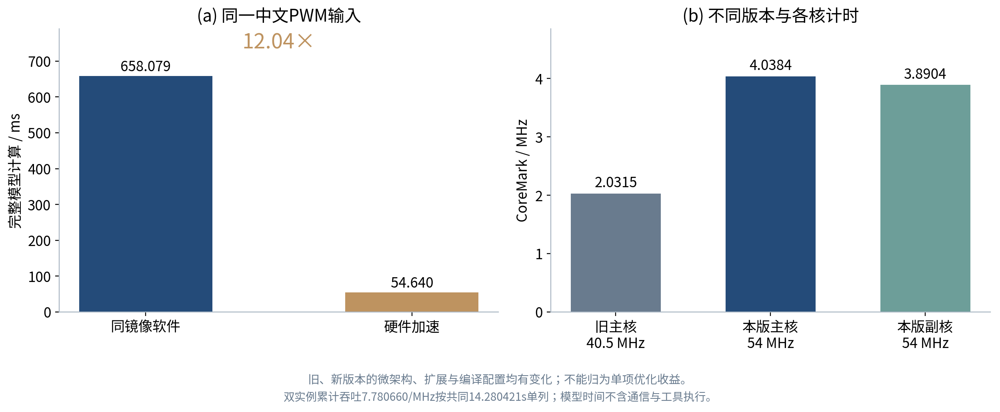

# 澄灯 LumaRV

**面向工业检修照明的语境感知控制系统**

“只关闭LED0，其他LED保持不变。”一句话里既有操作，也有限制。LumaRV把两者分开判断，再检查参数、执行操作并读回结果。演示以板上LED和PWM为控制对象，连接中文语义处理、RISC-V处理器与外设。



## 一句话怎样变成操作

检修时，操作员需要调整照明、保留其他状态指示，也需要确认控制器是否正常。LumaRV围绕这些任务组织交互：PWM调光、LED位保持、片内温度、周期计数和CPU自检。外接灯具通过驱动级接入，板上演示使用LED与PWM寄存器。



| 操作 | 中文请求 | 返回结果 |
|---|---|---|
| PWM | 请将PWM占空比设置为20%。 | 周期、高电平计数与占空比读回 |
| LED | 只关闭LED0，其他LED保持不变。 | 保留其余位的新掩码 |
| 温度 | 请读取FPGA当前温度。 | FPGA片内温度 |
| 计数 | 读取计数器现在的数值。 | 32位周期计数 |
| CPU自检 | 执行一次CoreMark测试。 | CRC、运行时间和成绩 |

## 语义模型与计算结构

模型不仅识别“PWM”或“LED”，还判断这句话是在下命令、解释操作，还是提出超出设备能力的要求。明确的机器指令直接解析；中文请求先判断语境，再按需运行完整编码器。三条路径共用工具、参数和能力检查，写入LED/PWM后读取寄存器核对。



| 组成 | 本项目的实现 |
|---|---|
| 字节编码器 | 两层d64、4个注意力头，学习型2/3-gram记忆；4MAC计算 |
| 位置语义头 | 全局1024、首尾各512特征；2048 → 64 → 16；8MAC计算 |
| 工具残差 | 受约束的70 → 5分支，由CPU计算 |
| 整数运行时 | INT4/INT8权重与INT32累加，197,816B学习权重 |
| 数据复用 | 128KiB常驻权重缓存，逐字非零位图跳过空特征 |
| 操作链路 | 语境判断、参数检查、位保持操作、写后读回 |

编码器的低比特工具调用和短语记忆思路参考[Needle](https://github.com/cactus-compute/needle)。任务语料、位置语义头、工具残差、整数运行时、计算侧核及外设控制链路由本项目设计。YOLO解决图像中的目标检测；LumaRV处理中文请求中的工具、参数与执行语境，两者面向不同任务。

语境与工具分支使用**25,014条训练文本**：9,155条合法操作、15,859条非执行或能力边界文本，其中包含2,800条适配标注的MASSIVE中文域外语料。用户编写的四批指令用于实板回归。



## 运行结果



| 指标 | 结果 |
|---|---|
| CPU | RV32IM，五级流水，40.5MHz |
| CoreMark/MHz | **2.031490**；1200次迭代，五项CRC通过 |
| 中文PWM完整模型 | **74.567ms**；同镜像软件路径999.170ms，加速**13.40倍** |
| 控制往返 | 四句各10次，中位数**1.40～5.16ms**，含USB与主机调度 |
| 模型分类：1138条开发评价 | 1058 → **1087**条正确 |
| 模型分类：900条难例 | 653 → **685**条正确 |
| 四批实板指令 | 24/25、25/25、25/25、25/25 |

控制往返与完整模型计时对应不同路径；版本对照包含多项改动。两组模型评价文本已参与开发。四批实板记录中另有一条81字节输入超过64字节协议上限，范围内98/99符合预期。

## 部署运行

硬件为盘古200Pro+，PG2L200H-6 / FBB676；使用PDS2022.2-SP6.4、RV32IM GCC和Python3。

### 1. 生成固件

```bash
make -C 03_sw/model \
  ROOT="$PWD" \
  TOOLCHAIN=/path/to/riscv32-unknown-elf- \
  OUT="$PWD/07_runs/model" \
  board-image
```

### 2. 下载到RAM

在PDS中打开`06_pango_active/run_impl.tcl`，按本机目录修改`taskRoot`和`taskDir`后运行。通过PDS Programmer把`06_pango_active/generate_bitstream/production.sbit`下载到RAM。断电后需重新下载。

器件启动时隙：DONE T3、GWEN/GRSN T2、GOUTEN T1。

### 3. 打开控制台

```bash
python -m http.server 8765 --bind 127.0.0.1 --directory 05_tools/console
```

Edge访问 **http://127.0.0.1:8765/?present=1&baud=921600&arch=1**，选择CP210x串口、921600波特率。连接成功后短按KEY0，等待“就绪”。FTDI接口用于JTAG；串口一次由一个程序使用。

- **一键AI识别·PWM20%**：确认板卡模式后发送中文PWM请求，显示完整模型结果与回读。
- **快速控制**：准备完成后发送`led 37`，查看LED变化与掩码。
- **CPU自检**：运行CoreMark，约14.6秒后显示CRC与成绩。
- **三维结构**：旋转、分层并查看处理模块。

### 目录

```text
01_rtl/           CPU、Cache、存储、外设和计算单元
02_tb/            RTL与系统测试
03_sw/            固件、整数模型运行时和驱动
04_model/         模型与数据处理
05_tools/console/ 串口控制台和三维展示
06_pango_active/  PDS工程、约束、ROM与RAM位流
07_runs/          训练、仿真和板卡运行结果
09_refs/          依赖与许可证
```

本项目采用[Apache-2.0许可证](LICENSE)。依赖包括[CoreMark](https://github.com/eembc/coremark)、[MASSIVE](https://github.com/alexa/massive)和[Three.js](https://github.com/mrdoob/three.js)，各自保留原许可证。
