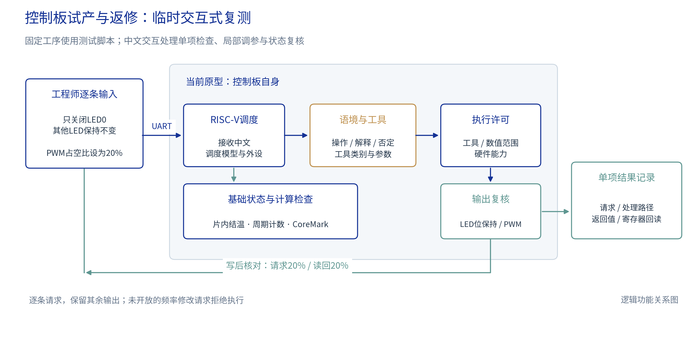
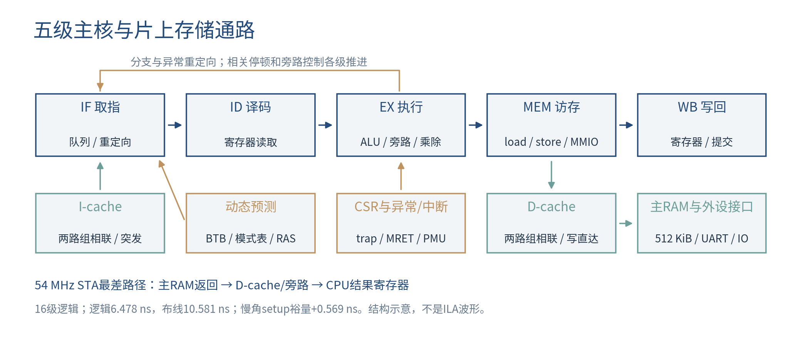
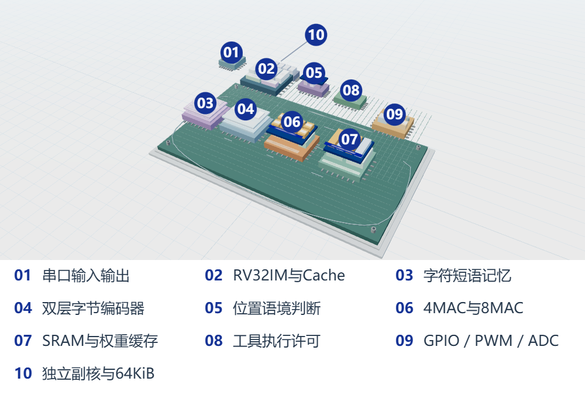
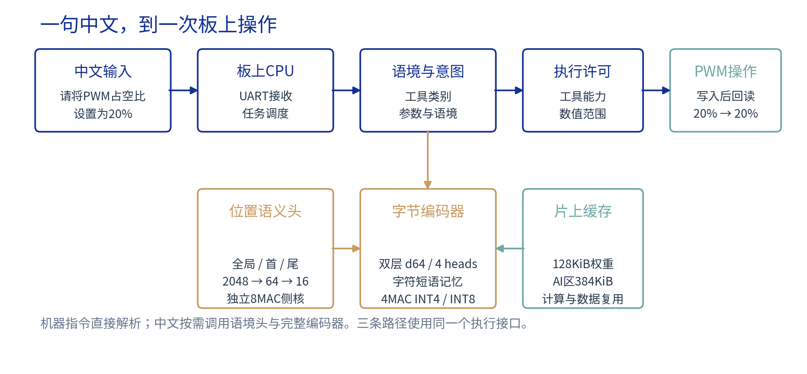
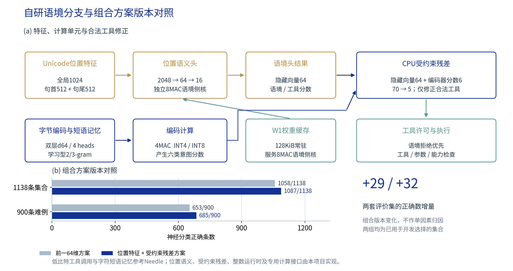
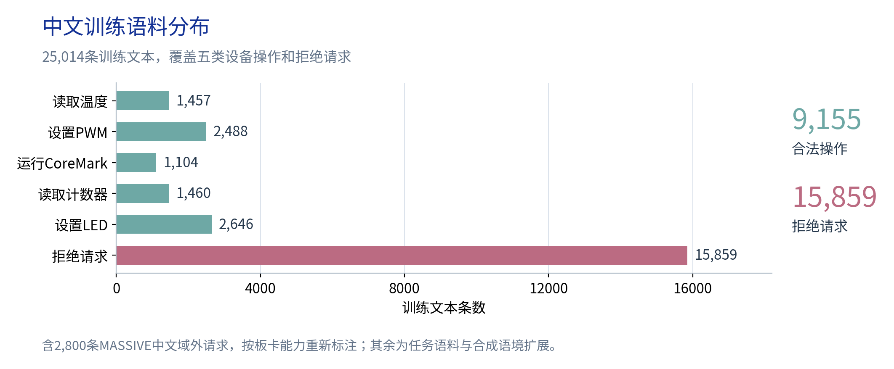
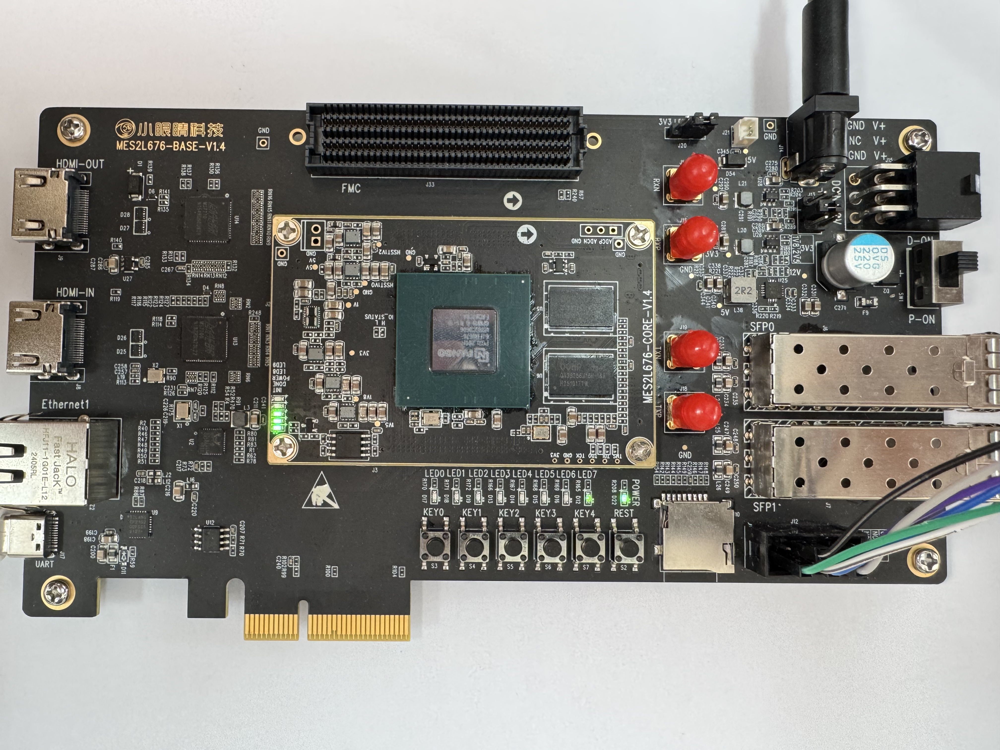
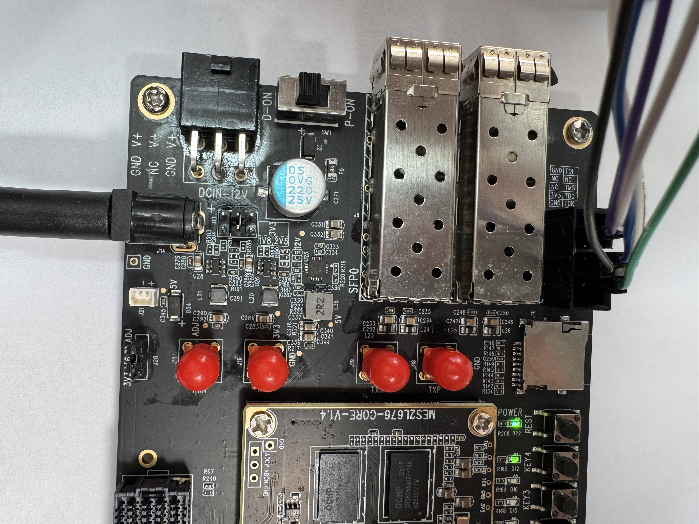
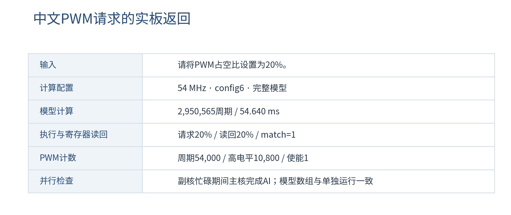
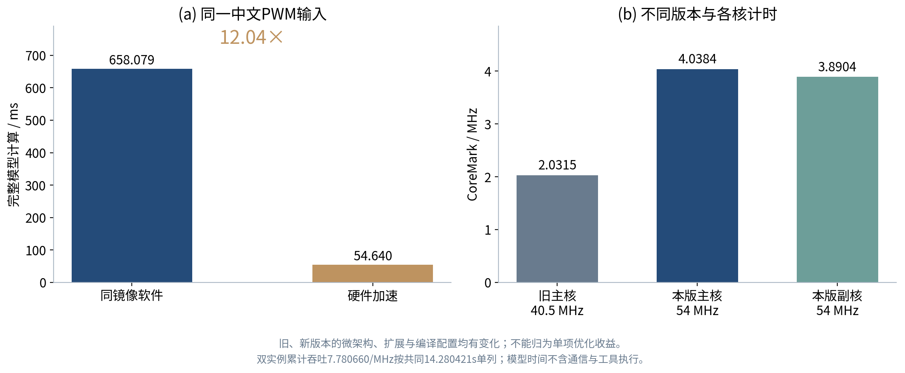

# 澄灯 LumaRV 面向控制板试产与返修的语境感知双核调试系统

## 摘要

控制板完成固定测试后，工程师还会临时检查某一路输出，并要求保留其他状态。澄灯LumaRV在开发板上实现这类中文请求的处理：主核完成语境与工具判断、参数检查和寄存器读回，副核在私有存储中运行CoreMark。针对片上资源，我们设计位置语义分支、受约束工具残差和4/8MAC两类计算单元。指定中文PWM样本的完整模型计算由658.079 ms降至54.640 ms，整数输出一致。系统在PG2L200H上以54 MHz运行，主核CoreMark/MHz中位数4.038437，双独立实例累计吞吐7.780660/MHz。本文给出模型训练、资源与时序以及实板指令结果。

## 第一部分 作品概述

### 1.1 功能与特性

系统支持结温与周期计数读取、LED整体及单灯位操作、1kHz PWM占空比设置和CoreMark。LED/PWM写入后读取寄存器，核对请求值与保存值。多动作、参数越界及未开放能力的请求拒绝执行。副核可后台运行计算检查，主核继续处理交互。

### 1.2 应用领域

一块控制板完成固定测试后，工程师根据故障疑点追加复测：先设置一个已知输出，再单独改变其中一位，要求其他通道保持；或微调PWM占空比，核对请求值与寄存器读回。固定流程仍用脚本，中文入口处理临时请求及其中的限制。我们用开发板自身验证这条操作链路，副核后台运行CoreMark时，主核完成中文PWM请求与回读。接入具体产品还需适配型号接口和测量工装，产线节拍收益尚未测量。

### 1.3 主要技术特点

系统由两颗五级RV32IM软核、各自Cache和存储、4MAC字节编码器、8MAC位置语义侧核及外设组成。主核运行交互、整数模型和执行接口；副核使用64 KiB私有RAM，不访问AI引擎和外设。模型结合学习型短语记忆、位置语义分支与小型工具残差。

### 1.4 主要性能指标

表1 主要性能指标

| 指标 | 结果 |
|---|---|
| 主频 / CPU性能 | 54 MHz双核；主核4.038437 CoreMark/MHz |
| 指定中文PWM模型 | 54.640 ms；同镜像软件加速12.04倍 |
| 轻量路径往返中位数 | 1.32～3.66 ms；四句各n=10 |
| 学习权重 / 存储 | 197,816 B；主存512 KiB、W1缓存128 KiB、副核64 KiB |
| 布局布线资源 | 55,277 LUT、39,035 FF、342.5 DRM、40 APM |

### 1.5 主要创新点

（1）位置感知语义模型。一句话提到外设，可能是在下命令，也可能只是解释或否定。我们在字符短语记忆之外，加入全局与前后半句的位置特征，经2048→64→16分支判断语境和工具。语境与工具分支使用25,014条训练文本，覆盖合法操作、否定、转述、多动作和能力边界。

（2）受约束工具残差。将位置分支的64维隐层与编码器六类分数组成70维输入，生成五类合法工具的修正量。当前候选不是拒绝、前两类分差不超过256时，才加回修正；后续语境否决与参数许可仍然有效。它用于减少合法工具混淆，不承担开放式回答或多工具规划。

（3）异构低比特推理。字节编码器使用4MAC，位置语义头使用8MAC；语义头第一层的128 KiB INT8权重常驻八个bank，并跳过全零特征组。指定中文PWM样本的完整模型由同镜像软件658.079 ms降至54.640 ms，输出数组一致。双核分工使后台CoreMark与前台AI、IO操作可在已测任务中并行。

### 1.6 设计流程

从五类板卡操作与参数范围建立语料，训练并导出整数参数；实现CPU、Cache和两类乘加单元，对照C参考验证数值；经PDS布局布线与时序分析后，在开发板运行中文请求、写后读回和双核基准。

## 第二部分 系统组成及功能说明

### 2.1 整体介绍

图1给出一次追加复测。主核逐条处理请求，副核在独立存储中运行CoreMark。已有实板记录覆盖副核忙碌期间的完整中文PWM模型与寄存器读回，模型数组与单独运行一致。该记录验证具体任务可以并行，尚未形成空闲/忙碌条件下的延迟分布对照。

图1 控制板临时复测的交互与读回流程

固定测试保留脚本。临时请求逐条执行，结果包含处理路径、参数与读回；要求改变未开放的PWM频率时拒绝。产品合格判定仍需相应工装和外部测量。

### 2.2 硬件系统介绍

#### 2.2.1 硬件整体介绍

PG2L200H以27 MHz晶振经GPLL生成54 MHz系统时钟。主核连接UART、片内温度、GPIO、PWM与32位周期计数，主SRAM512 KiB、语义W1缓存128 KiB。副核配64 KiB RAM、32 KiB指令Cache及4 KiB数据Cache，经邮箱返回状态、周期和CRC。两核BTB分别512和64项，模式表与返回地址栈另计。

图2 主核五级流水线与片上存储通路

图3 模块分层与片上计算结构

三维图按处理器、语义计算、存储和外设分层，用于说明逻辑连接与请求路径。网页可旋转、展开模块，PPT保留可交互模型；三维动画不参与性能计时。

#### 2.2.2 机械设计介绍

使用厂家开发板、配套电源、USB串口和JTAG线缆。展示机位使板卡LED与电脑返回结果可以同框观察。

#### 2.2.3 电路各模块介绍

表2 硬件模块与接口

| 模块 | 关键输入 | 关键输出 |
|---|---|---|
| CPU与Cache | 时钟、复位、访存响应 | 指令/数据地址、写数据、提交PC |
| 共享DMA | 计算任务、地址与读写请求 | 数据响应、任务归属、错误状态 |
| 4MAC编码器 | INT4权重、INT8激活 | INT32累加值、任务状态 |
| 8MAC位置语义头 | INT8特征、常驻权重 | INT32语义分数、完成状态 |
| UART与外设 | 串口输入、按键、ADC采样 | 串口输出、LED、PWM寄存器值 |

PWM固定1kHz，周期与高电平计数共同决定占空比。LED整体掩码与单位置位/清位均返回读回值。这里核对寄存器配置，未进行外部引脚波形测量。

### 2.3 软件系统介绍

#### 2.3.1 软件整体介绍

控制台提供完整AI请求、快速控制、后台计算检查和CPU基准入口。模式切换收到确认后才发送工具请求；每条结果与就绪状态对应。双核基准分别显示各核成绩，并按共同时间计算累计吞吐。

图4 中文请求的处理流程

默认混合模式先对严格机器语法及部分明确中文命令做全句匹配和参数检查，命中后直接解析，不运行学习语境头；其余中文先运行语境头，再按需调用完整编码器。执行接口最终校验请求状态、参数和工具可用性，并返回读回结果。页面标记本次实际运行的路径。

#### 2.3.2 模型设计与训练

模型任务是判断执行语境和工具类别，不生成自由文本。工具包括温度、PWM、CoreMark、计数器和LED，另有拒绝类别；数值参数由固件解析。低比特工具调用与字符短语记忆参考Needle，具体来源与本项目实现见下表。

表3 参考基础与本项目设计

| 参考基础 | 本项目设计 |
|---|---|
| Needle低比特工具调用与字符短语记忆 | 板卡五类操作、中文语境分支与训练语料 |
| 通用Transformer编码器结构 | 双层d64整数运行时、首尾位置特征与70→5工具残差 |
| RISC-V指令集 | 五级CPU、Cache、异常中断与外设实现 |
| 整数乘加与同步RAM方法 | 4MAC编码器、8MAC位置语义侧核、常驻权重缓存与零组跳过 |
| MASSIVE中文语料 | 选择2,800条域外请求，按设备能力重新标注 |

字节编码器为两层d64、四注意力头，含学习型2/3-gram记忆。位置分支按Unicode字符中点划分前后两段：全局1024维，前后各512维，输入2048→64→16语义头。64维隐层与六类编码器得分经缩放和截断后组成70维输入，由CPU计算70→5残差。门控控制修正是否加回，语境否决仍然优先。

图5 自研语义分支与组合版本对照

组合版本在1138条开发集合中由1058条正确增至1087条，在900条难例中由653条增至685条。结构、训练及选择过程同时变化，这组版本对照不能分配为位置分支或残差的单独收益。

图6 语境与工具分支的训练文本分布

语境与工具分支使用25,014条训练文本：合法操作9,155条，拒绝及非执行表达15,859条。语料包含任务样本、合成语境扩展和2,800条按板卡能力重标注的MASSIVE中文域外请求。五类合法操作分布见图6。四批用户指令用于回归，训练规模并非仅有25句。

197,816 B学习权重导出为C数组并编入主核固件。4MAC编码器采用INT4/INT8权重，8MAC位置语义头采用INT8权重，两者INT32累加。语义头W1为2048×64字节，分八个bank常驻128 KiB缓存；首次经32位总线装载，计算时各bank每拍提供一个字节。

表4 软件模块与输入输出

| 软件模块 | 输入 | 输出 |
|---|---|---|
| 输入处理 | UTF-8文本、长度及帧校验 | 单条请求或输入错误 |
| 语境与工具模型 | 字符、位置特征及编码向量 | 语境判断、六类分数 |
| 参数与许可 | 原文、工具候选、硬件能力 | 工具、参数及操作类型 |
| 执行与显示 | 允许执行的请求 | 实际值、读回结果、计时及就绪 |

## 第三部分 完成情况及性能参数

### 3.1 整体介绍

实板已完成中文请求、LED/PWM读回和双核基准。副核后台忙碌期间主核完成完整PWM模型，重复启动被拒绝；十种初始LED掩码下的20项位保持检查通过。图7为开发板实物，图8展示供电与JTAG连接。

图7 开发板实物全貌

图8 供电与JTAG连接

### 3.2 工程成果

#### 3.2.1 机械成果

采用开发板现有结构与连接件，展示布局以看清板卡、线缆和用户LED为准。

#### 3.2.2 电路成果

器件汇总使用55,277 LUT、39,035 FF、342.5个DRM36等效单元、40个APM、1个ADC和1个GPLL。下表按原始层次报告拆分CPU、AI及副核，父子模块不重复相加。

表5 层次资源使用

| 层次范围 | LUT | FF |
|---|---|---|
| 主核CPU及I/D Cache | 24,330 | 17,581 |
| 4MAC及8MAC计算区 | 8,678 | 6,987 |
| 副核子系统 | 18,704 | 13,866 |
| 外围、存储接口与顶层余项¹ | 934 | 601 |
| 层次表合计 | 52,646 | 39,035 |

¹余项由层次总数扣除前三项得到。原始层次LUT合计52,646，与器件汇总55,277口径不同；CoreMark/LUT使用器件汇总。

#### 3.2.3 软件成果

PWM请求20%时，读回20%，周期54,000、高电平10,800、使能1。副核状态单列，完成与CRC返回后才显示基准结果。图9摘录既有实板返回。

图9 中文PWM请求的计算与寄存器读回结果

### 3.3 特性成果

图10 指定中文PWM请求的完整模型软件与加速路径

同一镜像、同一中文PWM输入的完整模型：软件35,536,262周期、658.079 ms，加速路径2,950,565周期、54.640 ms，加速12.04388倍。编码器、语境、工具和残差数组一致；一次冷缓存记录56.718 ms。这些时间不含UART与工具执行。

表6 应用计时范围与实测结果

| 计时对象 | 实测结果 | 范围 |
|---|---|---|
| 指定中文PWM完整模型 | 54.640 ms | 板上计算，不含串口与工具执行 |
| 机器语法 / 语境分支 | 1.32～3.66 ms | 四条固定输入各10次原生UART往返中位数 |
| 双核计算自检 | 共同时间14.280421s | 每核3000迭代；两核CRC均通过 |

主核19次基准每次3000迭代，均通过CRC，耗时13.756066～13.762035秒，CoreMark/MHz中位数4.038437。副核3.890411/MHz。双实例从同一次邮箱启动到较晚的结束标记，共同14.280421秒；6000次迭代对应7.780660/MHz、420.155666次/秒，按器件汇总资源为0.00760091 CoreMark/LUT。共同窗口包含启动与结束标记开销。

两组开发集合分别包含196条合法/942条拒绝请求，以及200条合法/700条拒绝请求。集合已用于开发选择，表中统计神经分支的分类结果。

表7 原始神经分类结果

| 评价集 | 神经分类正确 | 误接受 | 误拒绝 | 合法工具错分 |
|---|---|---|---|---|
| 1138条 | 1087/1138（95.52%） | 50 | 0 | 1 |
| 900条难例 | 685/900（76.11%） | 190 | 24 | 1 |

1138条集合中的50次误接受和900条难例中的190次误接受，说明神经分支仍会把非执行请求判成可执行。合法工具错分单列，不能与误拒绝混为一项。

混合路径分别1135/1138、884/900正确，合法请求分别193/196、184/200；这两组开发集合中的应拒绝请求均未放行。混合结果包含语境、明确语法和参数/能力检查，不计作神经分类准确率。

四批用户原文实板结果依次24/25、25/25、25/25、25/25。一条81字节输入按协议上限拒绝；64字节以内99条中98条符合预期，一条CoreMark成绩询问被保守拒绝。强制完整模型另有一条LED0置位误拒绝：编码器选对LED，语境拒绝边际7超过阈值5；默认混合路径通过明确LED语法执行，未运行模型。拒绝前后LED/PWM配置保持。

主核PMU样本743,124,772周期、退役712,638,923条，CPI约1.043。CoreMark以独立算法计时，各核分别运行私有存储中的实例。全部基准算法使用同一编译配置，源码保持原样；应用与AI另用GCC14 O2。微架构、标准扩展与编译策略共同变化，现有结果不作单因素归因。

表8 编译工具链与选项

| 编译对象 | 工具链 | 主要选项 | 指令范围 |
|---|---|---|---|
| 应用与AI | GCC14 | -O2 | RV32IM、CSR、FENCE.I |
| 两核CoreMark全部算法 | GCC15 | -O3；-funroll-all-loops；-mtune=rocket | 上述基础加Zba/Zbb/Zbc/Zbs/Zicond |

编译选项和标准扩展已启用，但未逐项测量扩展收益。构建入口为05_tools/build_dual_firmware.py，两个实例各3000次。

54 MHz慢/快角setup裕量0.569/7.529 ns，hold裕量0.141/0.100 ns。最差慢角路径为主RAM读出，经D-cache返回和旁路，进入CPU结果寄存器；逻辑延迟6.478 ns、布线10.581 ns，共16级逻辑。该点通过已施加约束及实板验证，未据此宣称器件最高频率或完整外部I/O时序。

本版同源ILA尚未采集。流水线分析目前采用上述PMU样本；旧版ILA保留在历史资料中，不作为本构建波形。

## 第四部分 总结

### 4.1 可扩展之处

接入产品须定义型号工具、参数与接口，并配合外部工装测电压、电流和输出波形。应用收益可用同任务操作时间与人工干预次数评价，目前尚未完成这类对比。本版同源ILA仍需补采，现有PMU和旧版波形不代替该项要求。

### 4.2 心得体会

最初只把工具类别认出来，仍会遇到解释句、否定句和合法工具混淆。位置特征用于保留文字前后关系，小型残差处理合法类别间的修正；完整模型的LED0误拒绝也提醒我们，语境门控会挡住真正想执行的句子。

部署时，权重读法与端口时序同样影响资源。将语义头第一层权重分bank常驻，再跳过全零特征组，可以减少重复搬运；计算仍需与整数参考逐项对照。

双核把长计算与交互分开，已有样本证明两项任务可以同时完成。下一步应补独立语言评价、忙闲延迟分布和产品工装验证，而不是只围绕熟悉指令继续提高分数。

## 第五部分 参考文献

[1] RISC-V International. RISC-V Instruction Set Manual[EB/OL]. https://docs.riscv.org/reference/isa/.

[2] EEMBC. CoreMark benchmark[CP/OL]. https://github.com/eembc/coremark.

[3] Cactus Compute. Needle source repository[CP/OL]. https://github.com/cactus-compute/needle.

[4] Home Assistant. Intents architecture[EB/OL]. https://contributors.home-assistant.io/core/internals/intents/.

[5] FitzGerald J, Hench C, Peris C, et al. MASSIVE: A 1M-Example Multilingual Natural Language Understanding Dataset with 51 Typologically-Diverse Languages[EB/OL]. 2022. https://arxiv.org/abs/2204.08582.

[6] 紫光同创. 2026年FPGA创新设计赛道紫光同创选题指南[Z]. 2026.

[7] 紫光同创. Pango Design Suite User Guide及Fabric Configuration User Guide[Z]. PDS 2022.2-SP6.4.

[8] 开发板厂家. MES2L676-200HP硬件使用手册[Z]. v1.2.

[9] Three.js contributors. Three.js[CP/OL]. https://github.com/mrdoob/three.js.

[10] NI. Electronics Manufacturing Test Solutions[EB/OL]. https://www.ni.com/content/dam/web/pdfs/electronics_manufacturing_test_solutions_brochure.pdf.
