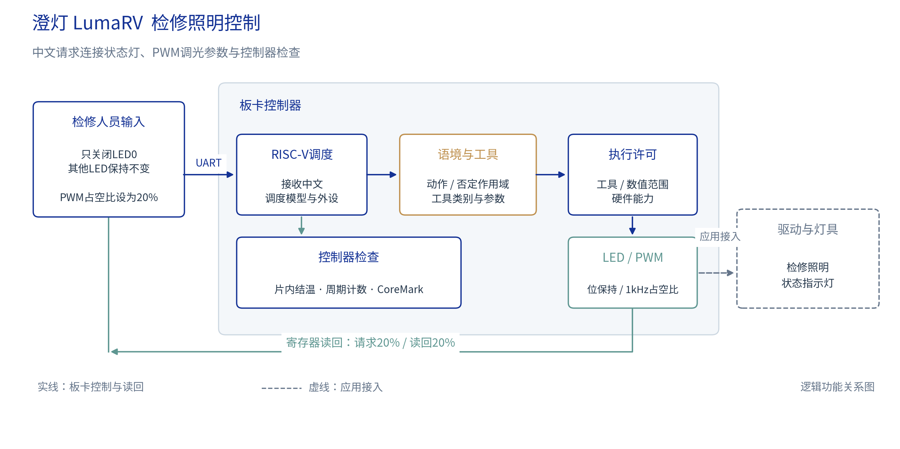

# 澄灯 LumaRV 面向工业检修照明的语境感知控制系统

## 摘要

检修设备时，操作人员既要调整照明，也要保留其他指示状态。澄灯LumaRV将这类操作接入中文界面：识别要做什么、判断是否允许，再把参数交给硬件。我们围绕五类设备操作设计语境与工具分支，使用25014条文本训练，将字符短语记忆、全局与首尾位置特征、受约束工具残差结合。部署学习权重197816B。4MAC编码器与8MAC位置语义侧核分工，128KiB常驻权重缓存减少重复搬运。系统在盘古200Pro+上实现五级RV32IM处理器，以板载LED和PWM接口演示照明控制器调试，支持FPGA结温、周期计数与CoreMark自检。40.5MHz下，指定中文PWM请求的完整模型计算为74.567ms，比同镜像软件路径快13.40倍；CoreMark为2.031490/MHz。四批用户原文实板结果为24/25、25/25、25/25、25/25，其中一条81字节输入按长度拒绝。

## 第一部分 作品概述

### 1.1 功能与特性

系统接受中文请求，读取FPGA结温和周期计数，设置LED掩码、单灯状态及1kHz PWM占空比，并执行CoreMark。单灯操作保留其他位，写操作返回寄存器读回值。明确语法、语境分支和完整编码器按请求分工。模型给出候选动作后，固件检查工具、参数与硬件能力；不支持、含多个动作或参数越界的请求不进入外设写操作。

### 1.2 应用领域

应用面向工业设备检修照明控制器：操作人员调整一个照明通道时，其他指示状态应保持不变；交接前还要检查控制器温度和CPU状态。例如“只关闭LED0，其他LED保持不变”对应单通道操作，“PWM占空比设为20%”对应调光参数。现场使用板载LED与PWM寄存器演示这些控制关系；外接照明灯具及功率驱动属于应用接入设计，尚未连接实测。温度读数来自FPGA片内传感器。

### 1.3 主要技术特点

语义计算结合双层d64字节编码器、Unicode字符短语记忆，以及全局1024维、首尾各512维的位置特征。2048→64→16位置语义头处理语境和工具信息，70→5受约束残差修正合法工具混淆。4MAC计算INT4/INT8编码器，8MAC计算INT8位置语义头，并使用128KiB常驻权重缓存和非零特征组跳过。CPU执行残差与工具许可。五级RV32IM、两路组相联I/D Cache、分支预测和异常中断提供运行基础。

### 1.4 主要性能指标

| 指标 | 结果 |
|---|---|
| 主频 / CPU性能 | 40.5MHz；2.031490 CoreMark/MHz |
| 指定中文PWM模型 | 74.567ms；同镜像加速13.40倍 |
| 轻量路径往返中位数 | 1.40～5.16ms；4句各n=10 |
| 学习权重 / 存储 | 197816B；SRAM512KiB + 缓存128KiB |
| 逻辑资源 | 19456LUT、19116FF、292.5DRM、33APM |

### 1.5 主要创新点

（1）面向中文设备操作设计语境与工具分支，将字符短语记忆和首尾位置特征结合，用25014条文本训练。

（2）将64维隐层与六类编码器输出组成70→5受约束残差，修正合法工具之间的混淆。

（3）按分支配置4MAC与8MAC，结合常驻权重缓存、非零特征组跳过，使指定PWM请求的完整模型计算加速13.40倍。

### 1.6 设计流程

确定控制器操作和参数范围，建立语料及参考模型；训练语境、工具分支并导出整数参数；实现CPU、存储与乘加加速器，对照C参考完成仿真；使用PDS综合、布局布线并分析时序；在开发板运行中文指令、寄存器读回和CoreMark，最后制作交互界面与分层动画。

## 第二部分 系统组成及功能说明

### 2.1 整体介绍

工业检修照明的控制器需要区分“调整当前通道”“保持其他状态”和“只询问、不执行”。澄灯LumaRV将这些关系落实为单工具请求：模型提出工具候选，CPU检查参数和硬件能力，再访问外设并读回结果。电脑控制台通过UART输入文字、汇总返回值。

图1的实线部分为现有控制器链路，虚线部分表示外接灯具的接入方向。LED用于通道状态演示，PWM寄存器表达调光参数；结温、计数器和CPU基准用于控制器检查。灯具驱动、照度测量与现场设备联动需要配套硬件后进一步实现。

### 2.2 硬件系统介绍

#### 2.2.1 硬件整体介绍

硬件平台采用PG2L200H及开发板现有接口。27MHz输入时钟经GPLL生成40.5MHz，按键KEY0用于系统复位。UART、片内温度采样、GPIO、PWM和32位周期计数器通过MMIO与CPU连接。主SRAM容量512KiB，其中CPU占128KiB、AI工作区占384KiB；位置语义头另有128KiB权重缓存。

三维图将计算、存储、语境判断和外设分层，交互页面可旋转、展开模块，并按一次PWM请求显示处理流程。它表示逻辑连接，模块位置不对应布局布线后的器件坐标。

#### 2.2.2 机械设计介绍

系统使用厂家开发板、配套电源、USB串口和JTAG线缆。展示时将板卡与电脑界面并排摆放，便于同时观察LED变化与操作结果。

#### 2.2.3 电路各模块介绍

| 模块 | 关键输入 | 关键输出 |
|---|---|---|
| CPU与Cache | 时钟、复位、访存响应 | 指令/数据地址、写数据、提交PC |
| 共享DMA | 计算任务、地址与读写请求 | 数据响应、任务归属、错误状态 |
| 4MAC编码器 | INT4权重、INT8激活 | INT32累加值、任务状态 |
| 8MAC位置语义头 | INT8特征、常驻权重 | INT32语义分数、完成状态 |
| UART与外设 | 串口输入、按键、ADC采样 | 串口输出、LED、PWM寄存器值 |

PWM固定为1kHz，通过周期与高电平计数设置占空比。LED支持整体掩码和单灯置位、清位。写操作完成后再次读取寄存器，核对请求值与保存值；该读回未测量外部引脚波形。

### 2.3 软件系统介绍

#### 2.3.1 软件整体介绍

控制台提供AI识别、快速控制和CPU自检三个入口。AI入口先配置完整模型路径，收到板卡确认后再发送中文请求；快速控制处理明确设备语法；CPU自检运行CoreMark并显示CRC与成绩。请求与返回逐条对应，上一条就绪后再发送下一条。

处理路径分为三类：机器指令直接解析；自然语言先判断语境，再由明确语法提取工具和参数；未命中明确语法时运行完整编码器。AI入口还可要求本次请求运行完整模型。语境判断拒绝的请求不会被后续工具解析重新放行。三类路径共用参数、能力检查与执行接口。

#### 2.3.2 模型设计与训练

AI任务分为语境判断和工具识别：一句话是在要求执行，还是解释、假设、引用或否定；若可执行，再识别温度、PWM、CoreMark、计数器或LED。模型同时保留拒绝类别，参数由固件解析。与图像检测输出物体类别和位置不同，本作品围绕中文中的动作、条件和设备参数设计。

| 参考基础 | 本项目设计 |
|---|---|
| Needle低比特工具调用与字符短语记忆 | 板卡五类操作、中文语境分支与训练语料 |
| 通用Transformer编码器结构 | 双层d64整数运行时、首尾位置特征与70→5工具残差 |
| RISC-V指令集 | 五级CPU、Cache、异常中断与外设实现 |
| 整数乘加与同步RAM方法 | 4MAC编码器、8MAC位置语义侧核、常驻权重缓存与零组跳过 |
| MASSIVE中文语料 | 选择2800条域外请求，按设备能力重新标注 |

双层d64字节编码器包含四个注意力头和学习型2/3-gram记忆。位置分支汇总全局1024维、首尾各512维特征，输入2048→64→16位置语义头。64维隐层与六类编码器输出组成70维向量，70→5受约束残差修正合法工具之间的判断；这部分由CPU标量执行。

与前一64维候选相比，当前组合版本在1138条集合的神经正确数由1058增至1087，在900条难例中由653增至685。训练与结构同时发生调整，这组数字说明组合版本的变化，不能单独归因于某一个模块。

语境与工具分支共使用25014条训练文本。合法操作9155条，包括温度1457、PWM2488、CoreMark1104、计数器1460和LED2646条；拒绝请求15859条，覆盖解释、假设、引用、否定、多动作、越界能力等表达。语料结合任务样本与合成语境扩展，并选取2800条MASSIVE中文域外请求，按本板卡能力重新标注。四批用户指令用于回归，不是全部训练文本。

模型在服务器训练，学习权重197816B，导出为C头文件和定点常量后编入固件。4MAC编码器采用INT4权重与INT8激活；8MAC位置语义头采用INT8权重，第一层权重驻留128KiB缓存，并跳过全零特征组。两类引擎均使用INT32累加。CPU继续执行残差、参数解析与工具许可。

| 软件模块 | 输入 | 输出 |
|---|---|---|
| 输入处理 | UTF-8文本、长度及帧校验 | 单条请求或输入错误 |
| 语境与工具模型 | 字符、位置特征及编码向量 | 语境判断、六类分数 |
| 参数与许可 | 原文、工具候选、硬件能力 | 工具、参数及操作类型 |
| 执行与显示 | 允许执行的请求 | 实际值、读回结果、计时及就绪 |

## 第三部分 完成情况及性能参数

### 3.1 整体介绍

开发板已完成中文请求、语义计算、LED/PWM寄存器访问及CPU基准运行。展示以控制器为对象：观察板载LED、核对PWM寄存器，并读取FPGA结温和CPU状态。

图6 系统全貌照片待插入

图7 板卡与连接细节照片待插入

### 3.2 工程成果

#### 3.2.1 机械成果

采用开发板现有结构与连接件，展示机位以看清板卡、线缆和用户LED为准。

#### 3.2.2 电路成果

已实现CPU、Cache、主存、权重缓存、两个乘加计算单元及板载外设。CPU运行程序和模型调度，计算单元通过DMA访问数据。综合结果为19456LUT、19116FF、292.5个DRM36等效单元和33个APM。

#### 3.2.3 软件成果

控制台逐条显示模型是否参与、执行工具、参数和读回值。图8中的中文PWM请求要求占空比20%，读回20%，周期40500、高电平8100、使能为1；这些字段来自实板寄存器。

### 3.3 特性成果

同一固件、相同中文PWM输入下，完整模型的软件路径为40466391周期，加速路径为3019968周期，耗时由999.170ms降至74.567ms，加速13.39961倍。两路径比较的编码器、语境、工具和残差分数一致。该请求通过AI入口运行完整模型；74.567ms是这一输入的模型计算时间。

| 计时对象 | 实测结果 | 范围 |
|---|---|---|
| 指定中文PWM完整模型 | 74.567ms | 板上计算，不含串口往返与工具执行 |
| 机器语法 / 仅语境分支 | 1.40～5.16ms | 4条固定输入，各10次原生UART往返中位数；含USB与主机调度 |
| CPU自检 | 14.58517242～14.58517336s | 1200迭代CoreMark算法计时 |

40.5MHz下，15次1200迭代CoreMark运行均通过五项CRC，耗时14.58517242～14.58517336秒，约2.031490 CoreMark/MHz、0.004229 CoreMark/LUT。慢、快工艺角的建立与保持检查均通过；setup裕量分别为1.901ns和11.214ns，hold裕量为0.147ns和0.102ns。此结果对应40.5MHz工作点。

两套开发评价集的神经分类与混合系统结果见表。1138条集合含196条合法请求和942条拒绝请求；900条难例含200条合法请求和700条拒绝请求。两组均已用于开发选择，结果用于分析该任务上的表现。

| 评价集 | 神经分类正确 | 误接受 | 误拒绝 | 合法工具错分 |
|---|---|---|---|---|
| 1138条 | 1087/1138（95.52%） | 50 | 0 | 1 |
| 900条难例 | 685/900（76.11%） | 190 | 24 | 1 |

1138条集合中195/196条合法请求分类正确，另1条将CoreMark错分为温度；900条难例中175/200条合法请求分类正确，24条被拒绝，另1条将计数器错分为温度。合法工具之间的错分与误拒绝分别统计。

默认混合路径的正确数分别为1135/1138和884/900，其中合法请求为193/196、184/200。这两套开发集合中，执行许可均未放行应拒绝请求。系统判断同时使用语境、语法和参数检查，结果不计作原始神经分类准确率。

四批用户原文的实板结果依次为24/25、25/25、25/25、25/25。其中一条81字节输入触发长度限制；64字节范围内98/99符合预期。“我想知道这颗 CPU 的 CoreMark 成绩。”被语境分支保守拒绝，未启动基准。此次回归中拒绝请求前后的LED与PWM状态保持一致。使用模拟DOM的生产网页程序通过真实UART完成AI PWM、LED和CPU自检12个事务；另有250项网页状态机模拟测试。

CPU运行期间通过PMU计数周期、退役指令和缓存事件。CoreMark采样区间为590699592周期、退役364493010条，CPI约1.621；基准成绩采用590699515算法周期。现有ILA波形来自较早版本，本报告的当前CPU分析使用上述PMU结果。

## 第四部分 总结

### 4.1 可扩展之处

用于实际照明设备时，需要增加灯具驱动、隔离与保护电路，并测量PWM输出和亮度响应。FPGA结温也应与现场环境、灯具温度分开采集。模型方面应补充独立来源的多动作和否定语料，分析合法请求被拒绝及工具错分。后续硬件验证包括外部PWM波形、功耗与关键算法ILA测量。

### 4.2 心得体会

这个项目的难点在于让模型判断、计算资源和硬件动作配合起来。训练过程中，单纯增加隐藏层或拆分专家没有持续提高结果；加入首尾位置特征等设计后，语境与工具判断有所改善。小型残差用于纠正合法工具之间的混淆，额外存储开销较小。

部署时，模型数组能放进RAM还不够。权重的读法、端口时序和零值特征的处理都会影响综合结果。将第一层权重常驻缓存，并按同步RAM组织访问后，LUT和触发器开销明显降低，计算结果与参考保持一致。

交互设计也影响使用体验。把所有请求都送入完整模型会增加等待，直接语法、语境判断和完整编码器分开处理后，界面既能快速控制，也能展示自然语言模型。执行后再读回寄存器，可以及时发现参数或操作结果是否符合预期。后续仍需要用更多独立语料考察否定、多动作和能力边界，而不是只增加熟悉句式。

## 第五部分 参考文献

[1] RISC-V International. RISC-V Instruction Set Manual[EB/OL]. https://docs.riscv.org/reference/isa/.

[2] EEMBC. CoreMark benchmark[CP/OL]. https://github.com/eembc/coremark.

[3] Cactus Compute. Needle source repository[CP/OL]. https://github.com/cactus-compute/needle.

[4] Home Assistant. Intents architecture[EB/OL]. https://contributors.home-assistant.io/core/internals/intents/.

[5] FitzGerald J, Hench C, Peris C, et al. MASSIVE: A 1M-Example Multilingual Natural Language Understanding Dataset with 51 Typologically-Diverse Languages[EB/OL]. 2022. https://arxiv.org/abs/2204.08582.

[6] 紫光同创. 2026年FPGA创新设计赛道紫光同创选题指南[Z]. 2026.

[7] 紫光同创. Pango Design Suite User Guide及Fabric Configuration User Guide[Z]. PDS 2022.2-SP6.4.

[8] 开发板厂家. MES2L676-200HP硬件使用手册[Z]. v1.2.

[9] Three.js contributors. Three.js[CP/OL]. https://github.com/mrdoob/three.js.
